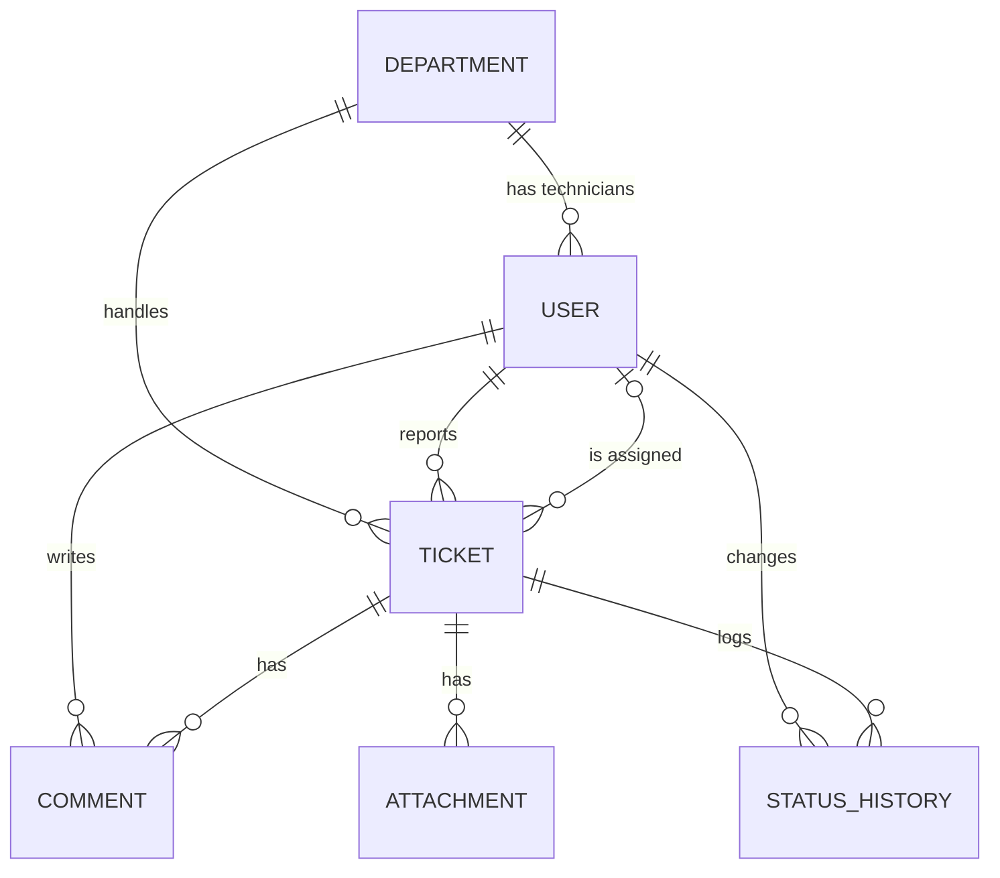
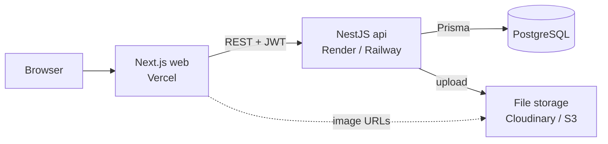

# Ticketing System — Design

A maintenance ticketing system. Staff report issues (broken aircon, faulty socket, IT problem), an admin assigns a technician from the right department, and the technician works the ticket through to resolution.

Portfolio project. Monorepo: `api/` (NestJS + Prisma + PostgreSQL) and `web/` (Next.js + TypeScript + Tailwind).

## Roles

| Role | Can do |
|---|---|
| REPORTER | Default role on sign-up. Create tickets, see and comment on **their own** tickets, close or reopen a resolved ticket they reported. |
| TECHNICIAN | Belongs to a department. See tickets **assigned to them**, move them to IN_PROGRESS / RESOLVED, comment, upload photos. |
| ADMIN | See everything. Manage users (role, department) and departments, assign technicians, reject invalid tickets, view the dashboard. |

## Ticket status flow

```
OPEN        -> ASSIGNED     (admin, via assign endpoint)
OPEN        -> REJECTED     (admin)
ASSIGNED    -> IN_PROGRESS  (assigned technician)
IN_PROGRESS -> RESOLVED     (assigned technician; sets resolvedAt)
RESOLVED    -> CLOSED       (reporter or admin)
RESOLVED    -> IN_PROGRESS  (reporter or admin; reopen, clears resolvedAt)
```

Rules:
- Any other transition is rejected with 400.
- Every transition writes a `StatusHistory` row (from, to, who, optional note).
- Transition rules live in one place (`tickets/ticket-status.ts`), not in controllers.

## Data model (Prisma)

```prisma
enum Role { REPORTER TECHNICIAN ADMIN }
enum TicketStatus { OPEN ASSIGNED IN_PROGRESS RESOLVED CLOSED REJECTED }
enum Priority { LOW MEDIUM HIGH URGENT }

model Department {
  id      Int      @id @default(autoincrement())
  name    String   @unique
  users   User[]
  tickets Ticket[]
}

model User {
  id           Int         @id @default(autoincrement())
  name         String
  email        String      @unique
  password     String
  role         Role        @default(REPORTER)
  departmentId Int?
  department   Department? @relation(fields: [departmentId], references: [id])
  reported     Ticket[]    @relation("Reporter")
  assigned     Ticket[]    @relation("Assignee")
  comments     Comment[]
  createdAt    DateTime    @default(now())
}

model Ticket {
  id           Int             @id @default(autoincrement())
  title        String
  description  String
  location     String
  priority     Priority        @default(MEDIUM)
  status       TicketStatus    @default(OPEN)
  departmentId Int
  department   Department      @relation(fields: [departmentId], references: [id])
  reporterId   Int
  reporter     User            @relation("Reporter", fields: [reporterId], references: [id])
  assigneeId   Int?
  assignee     User?           @relation("Assignee", fields: [assigneeId], references: [id])
  comments     Comment[]
  attachments  Attachment[]
  history      StatusHistory[]
  createdAt    DateTime        @default(now())
  updatedAt    DateTime        @updatedAt
  resolvedAt   DateTime?

  @@index([status])
  @@index([departmentId, status])
}

model Comment {
  id        Int      @id @default(autoincrement())
  body      String
  ticketId  Int
  ticket    Ticket   @relation(fields: [ticketId], references: [id], onDelete: Cascade)
  authorId  Int
  author    User     @relation(fields: [authorId], references: [id])
  createdAt DateTime @default(now())
}

model Attachment {
  id        Int      @id @default(autoincrement())
  url       String
  fileName  String
  ticketId  Int
  ticket    Ticket   @relation(fields: [ticketId], references: [id], onDelete: Cascade)
  createdAt DateTime @default(now())
}

model StatusHistory {
  id          Int           @id @default(autoincrement())
  ticketId    Int
  ticket      Ticket        @relation(fields: [ticketId], references: [id], onDelete: Cascade)
  fromStatus  TicketStatus?
  toStatus    TicketStatus
  changedById Int
  note        String?
  createdAt   DateTime      @default(now())
}
```

## ERD



## API

Base path `/api`. All endpoints need a JWT (`Authorization: Bearer <token>`) except register and login.

### Auth
| Method | Endpoint | Who | Notes |
|---|---|---|---|
| POST | `/auth/register` | Public | Always creates a REPORTER |
| POST | `/auth/login` | Public | Returns `access_token` |
| GET | `/auth/me` | Any | Current user |

### Users (admin)
| Method | Endpoint | Notes |
|---|---|---|
| GET | `/users?role=&departmentId=` | List with filters |
| PATCH | `/users/:id` | Change role / department |

### Departments
| Method | Endpoint | Who |
|---|---|---|
| GET | `/departments` | Any |
| POST | `/departments` | Admin |
| PATCH, DELETE | `/departments/:id` | Admin |

### Tickets
| Method | Endpoint | Who | Notes |
|---|---|---|---|
| POST | `/tickets` | Reporter | status = OPEN |
| GET | `/tickets?status=&priority=&departmentId=&search=&page=1&limit=10` | Any | **Scoped by role**: reporter sees own, technician sees assigned, admin sees all |
| GET | `/tickets/:id` | Involved users / admin | Includes comments, attachments, history. Not visible -> 404 |
| PATCH | `/tickets/:id` | Reporter, only while OPEN | Edit title / description / location / priority |
| PATCH | `/tickets/:id/assign` | Admin | Body `{ assigneeId }`; technician must be in the ticket's department; status -> ASSIGNED |
| PATCH | `/tickets/:id/status` | Depends on transition | Body `{ status, note? }`; validated against the flow above |

### Comments & attachments
| Method | Endpoint | Notes |
|---|---|---|
| GET, POST | `/tickets/:id/comments` | Involved users / admin |
| POST | `/tickets/:id/attachments` | multipart/form-data, images only, max 5 MB |
| DELETE | `/attachments/:id` | Uploader or admin |

### Dashboard (admin)
| Method | Endpoint | Notes |
|---|---|---|
| GET | `/dashboard/summary` | Counts by status and priority, overdue tickets, average resolution time |

## Architecture



- Business rules (roles, scoping, status flow) live only in the API. The web app never decides permissions.
- Local dev: `docker-compose.yml` runs PostgreSQL; the API reads `DATABASE_URL` and `JWT_SECRET` from `.env` (`.env.example` committed).
- `prisma/seed.ts` creates demo departments (Facilities, IT, Electrical) and one demo user per role, so reviewers can log in immediately.

## API folder structure

```
api/src/
├── prisma/            PrismaService
├── common/
│   ├── decorators/    @CurrentUser(), @Roles()
│   ├── guards/        JwtAuthGuard, RolesGuard
│   └── dto/           PaginationDto
├── auth/
├── users/
├── departments/
├── tickets/           incl. ticket-status.ts (transition rules)
├── comments/
├── attachments/
└── dashboard/
```

## Out of scope for MVP

Email notifications, SLA deadlines per priority, CSV export, real-time updates. Possible later additions.
